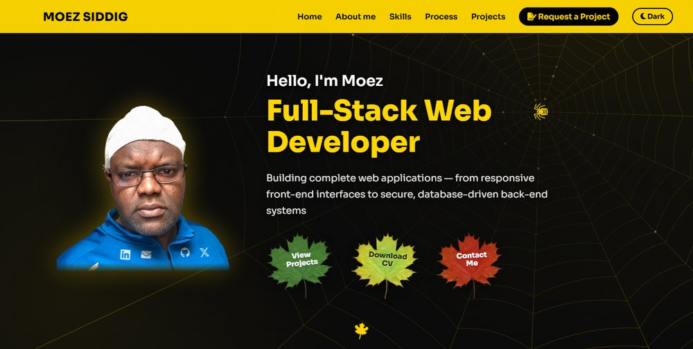
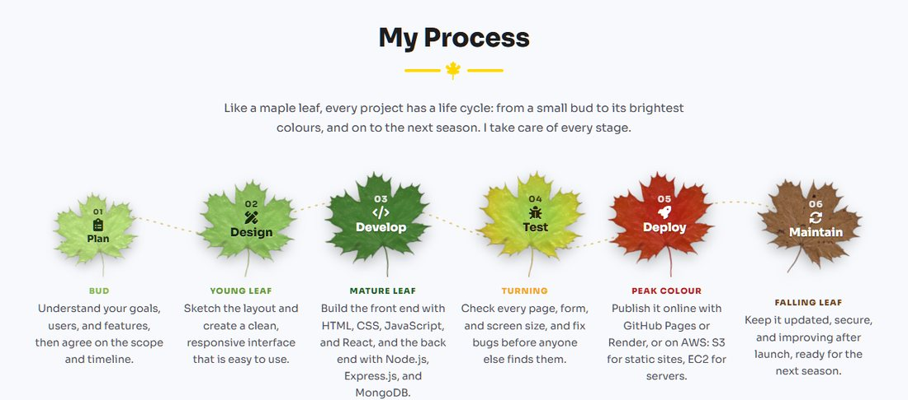

# Moez Siddig — Interactive Portfolio

A hand-built, responsive portfolio website written in plain **HTML, CSS and JavaScript**, with no frameworks or build tools. The animations are drawn with the HTML Canvas API.

**Live site:** https://moezsiddig.github.io/Interactive_personal_website/



## Highlights

- **Self-building spider web (Canvas):** in the hero, a spider drops in on a silk thread, the spokes shoot out, and it spins the web ring by ring. The threads ripple when the mouse touches them, and the spider runs to the vibration like it is catching prey.
- **Spring physics:** each thread point is held by a spring, damped, and pulled by its neighbours, so a touch spreads across the web like a wave.
- **Maple leaf life cycle:** the development process (Plan, Design, Develop, Test, Deploy, Maintain) follows the life of one real maple leaf, from a green bud to a falling brown leaf. A Python script recolours a single photo for each stage.
- **Leaf buttons:** the main calls to action are three maple leaves in different colours.
- **Dark mode:** remembered between visits, and applied before the first paint so the page never flashes light.
- **Contact form:** validated, sends requests straight to my inbox through FormSubmit, falls back to the visitor's email app, and includes a spam trap.
- **Skills with real logos:** each skill is a tile with its brand logo that opens the official site.
- **Responsive:** desktop, tablet and phone layouts, including a mobile menu.
- **Accessible:** keyboard focus styles, ARIA labels, and support for the "reduced motion" setting.
- **Performance:** animations pause when they are off screen or the tab is hidden, and the page images went from about 13 MB to under 1 MB.



## Built with

| Area | Tools |
| --- | --- |
| Markup and style | HTML5, CSS3 (Grid, Flexbox, custom properties, keyframe animations, media queries) |
| Interactivity | JavaScript (ES6+), HTML Canvas API, IntersectionObserver, ResizeObserver, MutationObserver |
| Images | Python (Pillow, NumPy) to recolour the leaf, rembg to remove backgrounds, WebP |
| Icons and logos | Font Awesome 6, Devicon, Simple Icons |
| Hosting | GitHub Pages |

## Project structure

```
index.html            Page content
css/style.css         All styles, light and dark mode, responsive rules
js/spider-web.js      Spider webs, the hero spider, and the roaming spider
js/project.js         Contact form, dark mode, mobile menu
images/               Photos, project screenshots and the leaf stages
cv/                   Downloadable CV (PDF)
```

## Run it locally

No installation is needed:

1. Download or clone the repository.
2. Open `index.html` in any modern browser.

To clone with Git:

```bash
git clone https://github.com/moezsiddig/Interactive_personal_website.git
```

## Other projects

- **Notes App:** full-stack note-taking app with Node.js, Express, MongoDB and Passport.js. [Live](https://notes-app-7cb8.onrender.com) · [Code](https://github.com/moezsiddig/notes-app)
- **Prophets Family Tree:** family tree data structure with Breadth-First Search. [Live](https://moezsiddig.github.io/family-tree-project/) · [Code](https://github.com/moezsiddig/family-tree-project)

## Credits

- Maple leaf photo by Robert Flogaus-Faust, [CC BY 4.0](https://creativecommons.org/licenses/by/4.0/), via [Wikimedia Commons](https://commons.wikimedia.org/wiki/File:Acer_platanoides_2_RF.jpg). Cut out and recoloured.
- Logos from [Devicon](https://devicon.dev/) (MIT) and [Simple Icons](https://simpleicons.org/) (CC0). Icons from [Font Awesome](https://fontawesome.com/) Free.

## Author

**Abdel Moez Mohammed (Moez Siddig)**, Full-Stack Web Developer, Ottawa, Canada.
Software Development Bootcamp, Circuit Stream (2026–2027).

[LinkedIn](https://www.linkedin.com/in/abdel-moez-mohammed-96880836b/) · [GitHub](https://github.com/moezsiddig)
